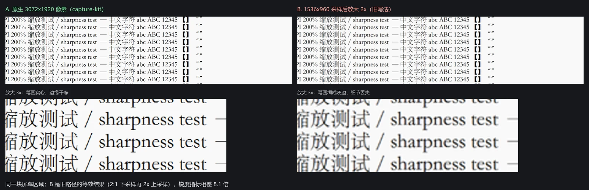
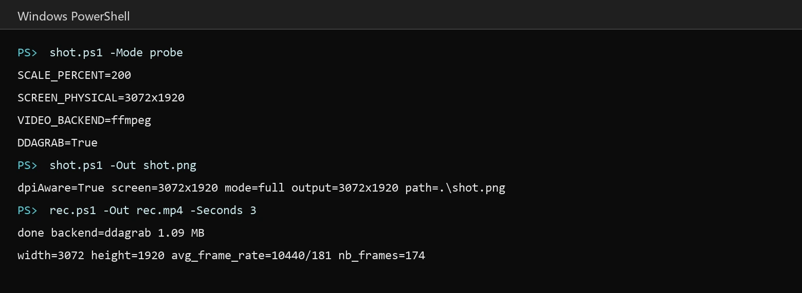

<p align="center"><a href="./README.md">中文</a> | <a href="./README.en.md">English</a></p>

<p align="center">
  
</p>

<h1 align="center">dsh-plugin-control-your-capture</h1>

<p align="center">High-fidelity screenshots and screen recording for DSH, captured at native pixels and scaled to a target size.</p>

<p align="center">
  <a href="https://nodejs.org/"></a>
  <a href="https://learn.microsoft.com/powershell/"></a>
  <a href="https://ffmpeg.org/"></a>
  <a href="https://www.chromium.org/Home/"></a>
  <a href="./LICENSE"></a>
</p>

## Overview

Blurry captures on high-DPI screens are usually a sampling problem, not an encoding one: the panel has far more physical pixels than the logical desktop exposes.

Measured on a 3072x1920 Windows display at 200% scaling: a process without DPI awareness captures only 1536x960, which then has to be upscaled into a 1080p timeline — text sharpness differed by roughly 8x. Recording shows the same pattern on that display: gdigrab reached about 19 fps while Desktop Duplication reached about 58 fps.



This plugin packages the fix as a skill. On mount it installs capture-sharp into the DSH global skill directory, so every workspace and session can use it, and the agent calls these scripts instead of reinventing capture code each time.

## Features

- **Native-pixel screenshots**: .NET GDI+ on Windows, screencapture on macOS, grim / gnome-screenshot / ImageMagick on Linux, with full screen, window, client area, region and high-quality scaling.
- **Native-resolution recording**: ddagrab (Desktop Duplication) first on Windows with a reported gdigrab fallback, avfoundation on macOS, x11grab on Linux.
- **Page capture at a target size**: --target-width expresses the intended width and the scale factor is derived as target width / CSS width, with no hardcoded multiplier.
- **One-command probe**: reports physical size, DPI, VIDEO_BACKEND and DDAGRAB before you shoot.
- **Graceful without ffmpeg**: screenshots and page capture keep working; only recording is disabled, with install commands for each platform.
- **Zero runtime dependencies**: Node built-ins only, and no second skill provider registered.

### Platforms and dependencies

| Capability | Windows | macOS | Linux | Without ffmpeg |
|---|---|---|---|---|
| Screenshot | .NET GDI+ | screencapture | grim / gnome-screenshot / ImageMagick | works |
| Page capture | Chrome/Edge + Node | same | same | works |
| Recording | ffmpeg | ffmpeg | ffmpeg | unavailable |
| Scaling | built in | sips | ImageMagick or ffmpeg | ImageMagick needed on Linux |

Capture paths are measured on Windows 10/11. The macOS and Linux paths are implemented but not verified on real hardware yet; probe reports which tools are available, and anything missing is stated explicitly.

## Installation

Prerequisites: DSH installed; Node 18+ and Chrome/Edge for page capture; ffmpeg only for recording.

```bash
dsh plugin add dsh-plugin-control-your-capture
```

Restart DSH once. On mount the plugin copies the skill into `$DSH_HOME/skills/capture-sharp`, where every workspace and session can see it.

## Usage

Once installed, plain language works: "take a screenshot", "record the screen", "this looks blurry", "grab assets for the demo video".



```powershell
# Windows: probe first, then capture
powershell -File "$DSH_HOME\skills\capture-sharp\scripts\shot.ps1" -Mode probe
powershell -File "$DSH_HOME\skills\capture-sharp\scripts\shot.ps1" -Out .\shot.png
```

```bash
# macOS / Linux
bash "$DSH_HOME/skills/capture-sharp/scripts/capture.sh" probe
bash "$DSH_HOME/skills/capture-sharp/scripts/capture.sh" shot --out ./shot.png

# Page capture (all platforms)
node "$DSH_HOME/skills/capture-sharp/scripts/page.mjs" --url https://example.com \
  --out ./page.png --width 960 --height 540 --target-width 1920
```

```powershell
# Recording: native resolution; use -ScaleTo for a 1080p target box
powershell -File rec.ps1 -Out .\rec.mp4 -Seconds 20
powershell -File rec.ps1 -Out .\rec1080.mp4 -Seconds 20 -ScaleTo 1920x1080
```

The full command table, verification steps and troubleshooting live in the bundled skill (SKILL.md and references/troubleshooting.md).

## Configuration

The skill installs into `$DSH_HOME/skills` by default. To change it:

- environment variable `DSH_CAPTURE_SKILL_ROOT`
- add `config: { skillRoot: '...' }` to this plugin's row in cordis.patch.yml

Upgrades replace the directory to avoid stale scripts; a same-named skill you installed yourself is never overwritten.

## Project structure

```text
lib/index.js            plugin entry: installs the bundled skill on mount
cordis.patch.yml        plugin row declaration
skill/capture-sharp/    bundled skill (SKILL.md, scripts, references)
```

## Releases

See [CHANGELOG.md](CHANGELOG.md) for version history.

## License

[MIT](LICENSE).
