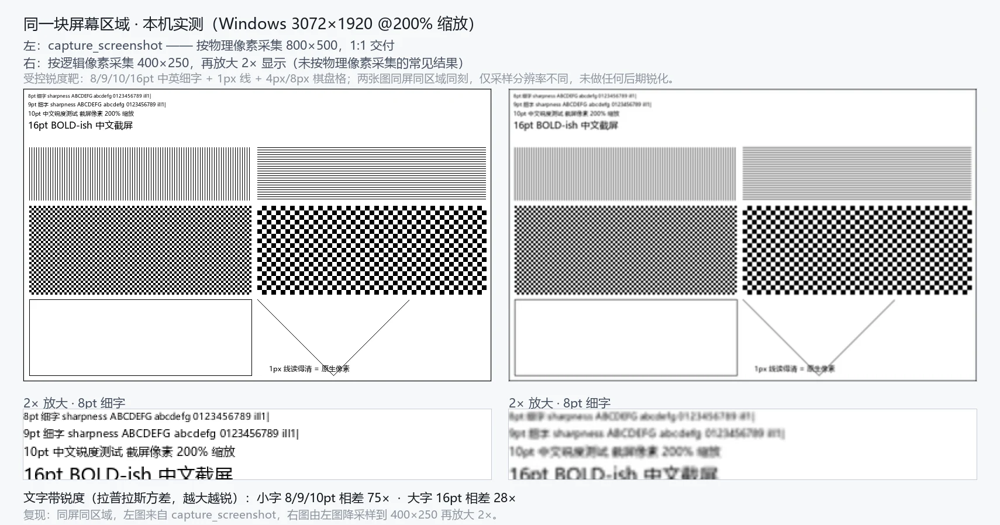

<p align="center">
  
</p>

<h1 align="center">dsh-plugin-control-your-capture</h1>
<p align="center">Screenshot and screen-recording tools for DSH: capture a display, a window or a region at physical pixels, and record a display or region to MP4 on a single-display Windows console session.</p>
<p align="center"><a href="README.zh.md">中文</a> · panel plugin v0.3.0 · skill v0.3.0</p>

<p align="center">
  <a href="https://nodejs.org/"></a>
  <a href="./LICENSE"></a>
  <a href="https://ffmpeg.org/"></a>
  <a href="https://github.com/HaoyanZhang123/dsh-plugin-control-your-capture"></a>
</p>

## Overview

`dsh-plugin-control-your-capture` is a DSH host plugin. It hands two capture abilities directly to the agent: **screenshots** (display / window / region) and **screen recording** (a display or a physical-pixel region on a single-display Windows console session). Capture happens at physical pixels and **never upscales**.

It solves concrete "look at this / record this" problems: capturing at logical pixels on a high-DPI screen makes text soft, and post-processing cannot restore it; hand-written ffmpeg commands tend to pick up low-frame-rate fallbacks, overwrite files and leave stray processes. The plugin puts both paths behind controlled tool calls with structured failures.

Intended for agents and users who need reliable, sharp screen evidence inside DSH, or a decodable MP4 of a session. **Not for**: offscreen page rendering, video editing, or audio capture.

## Features

- **Three tools, one execution path**: `capture_screenshot`, `capture_probe`, `capture_recording`; the skill contains no scripts and there is no second capture implementation.
- **Native physical pixels**: captures at the size the backend reports; `maxWidth` may downscale exactly once and the tool **never upscales**. Measured here on a 3072x1920 display at 200% scaling.
- **Two sizes, kept distinct**: `width` / `height` are the file on disk, `image.width` / `image.height` are what the model sees; a downscale surfaces as `model_image_downscaled`.
- **Recording with a quality gate**: fixed `libx264` / `veryfast` / CRF 14 / `yuv420p` / `+faststart`, no audio; `stop` runs FFprobe (`-count_frames`) plus a full decode and refuses to publish on failure.
- **Atomic and no-clobber**: same-directory hidden unique temp file; publishing never overwrites, a taken name becomes `out_renamed`.
- **Structured failures**: every failure carries `code` / `message` / `details` / `hint`; nothing degrades silently.
- **Zero runtime dependencies**: Node built-ins only; FFmpeg / FFprobe are explicitly probed external capabilities, and missing them only affects recording.

The same screen region at the same moment, changing only the sampling resolution (left: physical pixels 800x500; right: logical pixels 400x250 upscaled 2x):



## Support matrix

Grades: `stable` has real-machine evidence plus image review; `beta` is complete but only partly measured; `experimental` has no real-machine evidence; `unsupported` is rejected explicitly, never silently downgraded.

| Platform / session | Shot display | Shot window | Shot region | Rec display | Rec region |
|---|---|---|---|---|---|
| Windows 10/11 console (single display) | beta | beta | beta | **beta** | **beta** |
| Windows multi-display / mixed DPI / HDR | experimental | experimental | experimental | unsupported | unsupported |
| Windows RDP / session 0 / secure desktop | experimental | unsupported | experimental | unsupported | unsupported |
| macOS (Retina / non-Retina) | experimental | experimental | experimental | unsupported | unsupported |
| Linux X11 | experimental | experimental | experimental | unsupported | unsupported |
| Linux Wayland | experimental | unsupported | experimental | unsupported | unsupported |
| headless / CI | `no_display` | — | — | `no_display` | `no_display` |
| `target:"all"` | — | — | — | — | — |

- This matrix matches `capture_probe`'s `targets` / `recording.targets`; any mismatch is a defect.
- **Measured on this machine** (Windows 11, 3072x1920, 200%): screenshots work for display/region; recording produced display 3072x1920 at **57.48fps** and region 800x500 at **57.45fps**, 1 video / 0 audio, `-xerror` full decode exit 0, faststart effective; a **279.6s** recording completed normally, beyond the old 120s timeout.
- Only measured platform x target pairs get promoted; **no platform is claimed to work everywhere**.

## Installation

Requirement: DSH installed. The plugin itself has no runtime dependency; **recording additionally needs an external FFmpeg (with the `ddagrab` filter and `libx264`) and FFprobe** — screenshots do not.

```bash
dsh plugin add dsh-plugin-control-your-capture
```

- A fresh bundle can take effect through HMR; **replacing an installed package requires a DSH restart** to load the new module.
- On mount it registers three tools and installs the thin `capture-sharp` guidance skill into the global skill directory (default `$DSH_HOME/skills`).
- To check the environment, have the agent call `capture_probe` and read `targets`, `recording.missing` and whether the output root is writable.

## Usage

### Screenshots: capture_screenshot

| Parameter | Values | Notes |
|---|---|---|
| `target` | `display` / `window` / `region` | Defaults to `display`; no `all` |
| `display` | opaque id from `capture_probe` | Defaults to the display holding the active window |
| `window` | backend-resolvable window id | Only for `window`; a missing window fails with `window_not_found` |
| `region` | `{x, y, width, height}` | **Physical pixels** relative to the display origin, never across displays |
| `out` | workspace-relative path | Defaults to `output/capture/<uuid>.png`; must stay inside the workspace |
| `maxWidth` | positive integer | Downscales at most once, never upscales |

Cropping a region to read fine text:

```json
{ "target": "region", "region": { "x": 600, "y": 200, "width": 1600, "height": 900 } }
```

### Recording: capture_recording

| Parameter | Values | Notes |
|---|---|---|
| `action` | `start` / `status` / `stop` / `cancel` | Required |
| `recordingId` | opaque id returned by `start` | Required for status/stop/cancel; not allowed on start |
| `target` | `display` / `region` | Defaults to `display`; `window` / `all` unsupported |
| `region` | `{x, y, width, height}` | Physical pixels, display-relative, even width/height, fully on screen |
| `fps` | `30` / `60` | Defaults to 60 |
| `drawMouse` | boolean | Defaults to true |
| `out` | workspace-relative `.mp4` | Defaults to `output/capture/<uuid>.mp4` |

```json
{ "action": "start", "target": "display", "fps": 60, "drawMouse": true }
```

- `start` returns quickly with a `recordingId`; **`path` appears only on `completed`** — `starting` / `recording` / `stopping` carry no deliverable.
- One active recording per instance; other agents in the same workspace (including subagents) can cooperate with the same `recordingId`; a different workspace gets `recording_workspace_mismatch`; ids do not survive a restart.
- `stop` waits for muxing, FFprobe and a full decode, so it is slower than ordinary calls; a failure throws and delivers nothing.

### Page screenshots vs screen screenshots

This plugin captures **what is really displayed on the desktop** (physical pixels, never upscaled), so decide first:

- **The page is not on screen** (headless browser, offscreen rendering, minimized window): the plugin cannot see it and that is not its job. Use the rendering side (e.g. CDP) with `deviceScaleFactor` set to `capture_probe`'s `displays[].scaleFactor` (2 on this machine), or `Page.captureScreenshot` with `clip.scale`; emit PNG and do not downscale afterwards.
- **The page / window is on screen**: use this plugin with `target:"window"` or `target:"display"`; for fine text use `target:"region"` to crop a 1:1 area.
- **The image looks small to the model**: the attachment store downscales it (3072x1920 → about 2590x1619, `model_image_downscaled`); the file on disk stays sharp.

## Configuration

Optional keys live under this plugin's `config:` line; all may be omitted:

| Key | Default | Notes |
|---|---|---|
| `skillRoot` | `$DSH_HOME/skills` | Skill install root, must be an absolute path |
| `skillInstall` | `true` | `false` skips skill installation; tools still work |
| `skillCleanupOnUnload` | `false` | Only `true` removes the skill this plugin installed on unload/exit |
| `timeoutMs` | `20000` | Per-call timeout for screenshots/short commands; does not limit a whole recording |
| `maxWidth` | no scaling | Service-level default downscale width, overridable per call |
| `recordingMaxDurationSec` | `3600` | Maximum recording length, integer 1–86400; auto-finalizes at the limit |

An invalid config makes the plugin fail (fiber FAILED); defaults are never silently substituted.

## Project structure

```text
lib/index.js                 host entry: config validation, tool registration, cleanup
lib/service.js               the only spawn/kill point: screenshots, short and managed processes
lib/recording-service.js     recording sessions: state machine, single active slot, validation, publishing
lib/recording/windows.js     Windows DDA argument plan, capability probing, FFprobe quality judgement
lib/tool.js                  schemas and rendering for capture_screenshot / capture_probe
lib/recording-tool.js        schema and rendering for capture_recording
lib/adapters/{windows,macos,linux}.js  platform backends: raw bytes only
lib/native/windows-shot.ps1  DPI-aware Windows native helper
lib/png.js / lib/paths.js    PNG validation, output root, unique naming and atomic writes
skill/capture-sharp/         thin guidance skill (no scripts; staged from the skill source by the gate)
```

## Known limitations

- Recording is limited to `display` / `region` on a **single-display Windows console**: no audio, no window / multi-display / HDR / RDP / session 0, and no recording on macOS or Linux; `yuv420p` is lossy and **not pixel-identical to PNG**, with no lossless mode.
- Recording needs external FFmpeg / FFprobe (`ddagrab` + `libx264`): when missing the call fails with `backend_unavailable` and lists each item in `missing`; nothing is downloaded or bundled.
- After a **hard kill** (crash / force-quit) orphan FFmpeg processes and `.tmp-*.mp4` files are not guaranteed to be cleaned (0.3.0 has no Job Object).
- `start` means "the process is alive and the temp file is non-empty (header)"; FFmpeg output buffering can keep video data off disk until `stop`, and delivery quality is enforced by the `stop` FFprobe + full-decode validation.
- `target:"window"` can return a blank image for some GPU-composited windows (`PrintWindow` cannot reach the compositor layer); the result then carries `content_uniform` — switch to `display` or `region`.
- macOS / Linux screenshots have no real-machine evidence and stay `experimental`; Wayland may prompt for permission.

## Releases

- Version history and per-release changes live in [CHANGELOG.md](CHANGELOG.md).
- Upgrade path: **uninstall the old version, install the new one, restart DSH** (DSH does not auto-update installed plugins).
- This repository has not published a GitHub Release or an npm version yet; entries will be added here once it does.

## License

[MIT](LICENSE).
