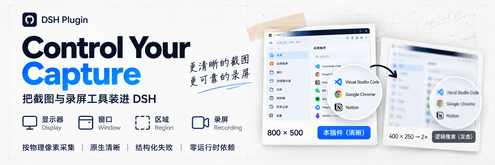

<p align="center">
  
</p>

<h1 align="center">dsh-plugin-control-your-capture</h1>
<p align="center">把截图与录屏工具装进 DSH：按物理像素抓显示器、窗口或区域，并在 Windows 单屏 console 录成 MP4。</p>
<p align="center"><a href="README.en.md">English</a> · 面板插件 v0.3.0 · skill v0.3.0</p>

<p align="center">
  <a href="https://nodejs.org/"></a>
  <a href="./LICENSE"></a>
  <a href="https://ffmpeg.org/"></a>
  <a href="https://github.com/HaoyanZhang123/dsh-plugin-control-your-capture"></a>
</p>

## 简介

`dsh-plugin-control-your-capture` 是一个 DSH Host 插件。它把两类采集能力直接交给 Agent：**截图**（显示器 / 窗口 / 区域）与 **录屏**（Windows 单屏 console 的显示器或物理像素区域），采集按物理像素进行，**永不放大**。

它解决的是「看图 / 录过程」这类具体问题：高 DPI 屏上按逻辑像素抓屏会让文字发虚，而事后缩放补不回来；录屏如果随手写 ffmpeg 命令，又容易踩到低帧率回退、覆盖文件、进程残留。插件把这两条路径收进受控的工具调用里，失败一律结构化报错。

适用对象：需要在 DSH 里稳定拿到清晰屏幕证据、或录制一段可解码 MP4 的 Agent 与使用者。**不适用**：网页离屏渲染截图、视频剪辑、音频录制。

## 核心特性

- **三工具、单一执行路径**：`capture_screenshot`、`capture_probe`、`capture_recording`；技能不含任何脚本，拒绝第二套采集实现。
- **原生物理像素**：按后端报告的物理尺寸采集；`maxWidth` 只允许缩小一次，**永不放大**。本机 3072×1920 / 200% 缩放实测正常。
- **两种尺寸语义分明**：`width` / `height` 是磁盘文件尺寸，`image.width` / `image.height` 是模型实际看到的尺寸；附件库降采样会给出 `model_image_downscaled`。
- **录屏有质量闸门**：固定 `libx264` / `veryfast` / CRF 14 / `yuv420p` / `+faststart`、无音频；`stop` 后跑 FFprobe（`-count_frames`）+ 完整解码校验，不通过就不发布。
- **原子且不覆盖**：临时文件同目录、隐藏、唯一；正式文件用 no-clobber 发布，重名时改名并给 `out_renamed`。
- **结构化失败**：所有失败带 `code` / `message` / `details` / `hint`，不静默降级。
- **零运行时依赖**：只用 Node 内置模块；FFmpeg / FFprobe 是明确探测的外部能力，缺失只影响录屏。

## 支持矩阵

等级定义：`stable` 有真机证据与读图结论；`beta` 实现完整但只有部分分支实测；`experimental` 实现存在但零真机；`unsupported` 明确拒绝，不静默降级。

| 平台 / 会话 | 截图 display | 截图 window | 截图 region | 录屏 display | 录屏 region |
|---|---|---|---|---|---|
| Windows 10/11 console（单屏） | beta | beta | beta | **beta** | **beta** |
| Windows 多屏 / 混合 DPI / HDR | experimental | experimental | experimental | unsupported | unsupported |
| Windows RDP / 会话 0 / 安全桌面 | experimental | unsupported | experimental | unsupported | unsupported |
| macOS（Retina / 非 Retina） | experimental | experimental | experimental | unsupported | unsupported |
| Linux X11 | experimental | experimental | experimental | unsupported | unsupported |
| Linux Wayland | experimental | unsupported | experimental | unsupported | unsupported |
| headless / CI | `no_display` | — | — | `no_display` | `no_display` |
| `target:"all"` | — | — | — | — | — |

- 本矩阵与 `capture_probe` 的 `targets` / `recording.targets` 一致；不一致即为缺陷。
- **本机实测**（Windows 11、3072×1920、200%）：截图 display/region 正常；录屏 display 3072×1920 @ **57.48fps**、region 800×500 @ **57.45fps**，1 video / 0 audio、`-xerror` 全文件解码 exit 0、faststart 生效；长录制 **279.6s** 正常完成，不受旧 120s 超时限制。
- 只有实测通过的「平台 × 目标」才会升级；**没有全平台支持**的声明。

## 安装

前提：已安装 DSH。插件本身零运行时依赖；**录屏额外需要外部 FFmpeg（含 `ddagrab` filter 与 `libx264`）和 FFprobe**，截图不需要。

```bash
dsh plugin add dsh-plugin-control-your-capture
```

- 新装 bundle 可经 HMR 生效；**替换已安装的包必须重启 DSH** 才会加载新模块。
- 挂载时会注册三个工具，并把极薄的 `capture-sharp` 引导技能装到全局技能目录（默认 `$DSH_HOME/skills`）。
- 检查环境：让 Agent 调 `capture_probe`，看 `targets`、`recording.missing` 与输出根是否可写。

## 使用方式

### 截图：capture_screenshot

| 参数 | 取值 | 说明 |
|---|---|---|
| `target` | `display` / `window` / `region` | 缺省 `display`；没有 `all` |
| `display` | `capture_probe` 返回的不透明 id | 缺省为活动窗口所在显示器 |
| `window` | 后端可解析的窗口 id | 仅 `window` 有意义；找不到就 `window_not_found` |
| `region` | `{x, y, width, height}` | **物理像素**，相对显示器左上角，不跨屏 |
| `out` | 工作区内相对路径 | 默认 `output/capture/<uuid>.png`；不得越界 |
| `maxWidth` | 正整数 | 只缩小一次，永不放大 |

裁一块区域看细字：

```json
{ "target": "region", "region": { "x": 600, "y": 200, "width": 1600, "height": 900 } }
```

### 录屏：capture_recording

| 参数 | 取值 | 说明 |
|---|---|---|
| `action` | `start` / `status` / `stop` / `cancel` | 必填 |
| `recordingId` | start 返回的不透明 id | status/stop/cancel 必填；start 不允许传 |
| `target` | `display` / `region` | 缺省 `display`；不支持 `window` / `all` |
| `region` | `{x, y, width, height}` | 物理像素、相对显示器左上角、宽高必须偶数、必须完整在屏内 |
| `fps` | `30` / `60` | 缺省 60 |
| `drawMouse` | boolean | 缺省 true |
| `out` | 工作区内相对 `.mp4` | 默认 `output/capture/<uuid>.mp4` |

```json
{ "action": "start", "target": "display", "fps": 60, "drawMouse": true }
```

- `start` 快速返回 `recordingId`；**`path` 只在 `completed` 出现**，`starting` / `recording` / `stopping` 都没有交付物。
- 同一实例同时只有一个活动录制；同一工作区内的其它 Agent（含子智能体）可凭 `recordingId` 协作；跨工作区为 `recording_workspace_mismatch`；重启后旧 id 失效。
- `stop` 会等封装、FFprobe 与完整解码，比普通调用慢；失败会 throw，且不会交付文件。

### 页面截图 vs 屏幕截图

本插件的截图抓的是**桌面上真实显示的内容**（物理像素，永不放大），所以先分清目标：

- **页面没显示在屏幕上**（无头浏览器、离屏渲染、最小化窗口）：插件抓不到，这也不是它的场景。用页面渲染侧（如 CDP）截图，把 `deviceScaleFactor` 设成 `capture_probe` 返回的 `displays[].scaleFactor`（本机为 2），或用 `Page.captureScreenshot` 的 `clip.scale`；输出 PNG，事后不要再缩放。
- **页面 / 窗口确实在屏幕上**：用本插件，`target:"window"` 或 `target:"display"`；要看清细字用 `target:"region"` 裁出 1:1 区域。
- **模型看到的图偏小**：附件库会把大图降采样（3072×1920 → 约 2590×1619，`model_image_downscaled`），磁盘文件仍然清晰。

## 配置

可选项写在本插件行的 `config:` 里，全部可省略：

| 键 | 默认 | 说明 |
|---|---|---|
| `skillRoot` | `$DSH_HOME/skills` | 引导技能安装根目录，必须绝对路径 |
| `skillInstall` | `true` | 设 `false` 不安装技能，工具照常可用 |
| `skillCleanupOnUnload` | `false` | 显式设 `true` 才在卸载/退出时删除本插件装的技能 |
| `timeoutMs` | `20000` | 单次截图/短命令超时；不影响整段录屏 |
| `maxWidth` | 不缩放 | 服务级默认缩小宽度，单次调用可覆盖 |
| `recordingMaxDurationSec` | `3600` | 录屏最长时长，整数 1–86400；到点自动正常结束 |

非法配置会让插件直接失败（fiber FAILED），不会静默用默认值掩盖。

## 项目结构

```text
lib/index.js                 Host 入口：配置校验、工具注册、清理
lib/service.js               唯一 spawn/kill 点：截图、短进程与 managed-process
lib/recording-service.js     录屏会话：状态机、单活动槽、校验与发布
lib/recording/windows.js     Windows DDA 参数计划、能力探测、FFprobe 质量判定
lib/tool.js                  capture_screenshot / capture_probe 的 Schema 与渲染
lib/recording-tool.js        capture_recording 的 Schema 与渲染
lib/adapters/{windows,macos,linux}.js  平台后端：只产出原始字节
lib/native/windows-shot.ps1  DPI 感知的 Windows 原生辅助
lib/png.js / lib/paths.js    PNG 校验、输出根、唯一命名与原子写入
skill/capture-sharp/         极薄引导技能（无脚本，由门禁从技能源生成）
```

## 已知限制

- 录屏只支持 **Windows 单屏 console** 的 `display` / `region`：没有音频、没有 window / 多屏 / HDR / RDP / 会话 0，macOS 与 Linux 不提供录制；`yuv420p` 有损，**不与 PNG 逐像素一致**，也没有无损模式。
- 录屏依赖外部 FFmpeg / FFprobe（需 `ddagrab` 与 `libx264`）：缺失时 `backend_unavailable` 并逐项列在 `missing`，**不自动下载、不捆绑**。
- **硬杀宿主**（崩溃 / 强杀）后的孤儿 FFmpeg 与 `.tmp-*.mp4` 不保证清理（0.3.0 未实现 Job Object）。
- `start` 的就绪条件是「进程存活 + 临时文件非空（头部）」；FFmpeg 的输出缓冲可能让视频数据到 `stop` 才完全落盘，交付质量由 `stop` 的 FFprobe + 完整解码把关。
- `target:"window"` 对部分 GPU 合成窗口可能返回空白图（`PrintWindow` 抓不到合成层），此时 `warnings` 会带 `content_uniform`，请改用 `display` 或 `region`。
- macOS / Linux 截图零真机，只能标 `experimental`；Wayland 可能弹授权。

## 更新与发布

- 版本历史与逐条变更见 [CHANGELOG.md](CHANGELOG.md)。
- 升级方式：**卸载旧版 → 安装新版 → 重启 DSH**（DSH 不支持已安装插件的自动更新）。
- 本仓库尚未发布 GitHub Release 与 npm 版本；发布后此处会补充入口。

## 许可证

[MIT](LICENSE)。
